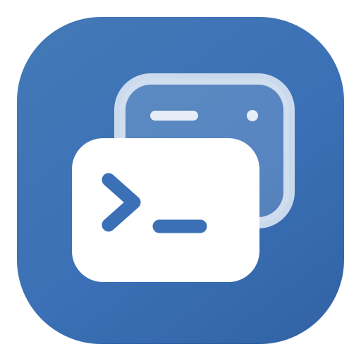

<div align="center">



# Remote SSH Brige

**让 AI Agent 通过 MCP，读写和操作你的远程服务器。**

连接 SSH · 读写文件 · 执行命令 · 持久终端 · 权限与审批

[快速开始](#快速开始) · [核心思想](#核心思想) · [MCP 工具](#mcp-工具) · [开发指南](docs/DEVELOPMENT.md)

Tauri 2 / Rust / React / TypeScript

</div>

---

把远程服务器接入 Agent 的工作流：读取配置、分析日志、修改文件，再运行命令验证结果。Remote SSH Brige 在本地提供 MCP 服务，通过 SSH / SFTP 完成远程操作，让你在桌面端管理服务器、授权工具、处理审批和查看执行记录。

支持 **Claude Code、Codex、Gemini CLI、OpenCode、Cursor 和 Pi** 一键配置接入。

## 核心思想

### Agent 提出操作，MCP 连接工具，SSH 抵达服务器

你描述任务，Agent 将任务拆成工具调用。应用根据已配置的服务器和权限处理请求，通过 SSH 执行命令、通过 SFTP 读写文件，再把结果返回给 Agent，供它判断下一步。


### 连接配置留在本地，能力按需开放

服务器连接和认证由本地应用管理。Agent 先发现已开放的服务器，再使用被授权的工具；密码和私钥口令保存在操作系统凭据库，服务器发现结果不包含凭据。

服务器权限分为文件读取、文件写入、文件删除、命令执行、终端操作、文件上传、文件下载和端口转发八项。文件写入包含创建、覆盖与局部编辑，并自动包含读取；新服务器默认仅开放读取。全局删除保护同时限制桌面和 MCP 删除。

### 让修改有依据，让结果可核验

围绕“读取 → 修改 → 验证”组织远程工作：先读取真实文件，再进行明确的文本编辑，最后读回内容或执行已授权的检查命令。`edit_file` 返回变更差异；应用记录操作目标、结果和耗时，便于回看过程。

需要人工介入时，可以开启敏感操作审批。批准仅对当前请求生效；权限检查和只读保护仍然适用。

## 可以用它做什么

| 场景           | Agent 的工作方式                                       |
| -------------- | ------------------------------------------------------ |
| 排查远程问题   | 读取日志与配置，执行已授权的诊断命令，结合输出分析原因 |
| 修改项目配置   | 读取原文，用 `edit_file` 定点替换，检查差异并读回验证  |
| 创建远程文件   | 用 `write_file` 写入脚本或配置，再按权限执行验证       |
| 持续处理任务   | 使用 SSH PTY 终端，保留工作目录与交互进程状态          |
| 管理多台服务器 | 发现已授权目标，按服务器 ID 操作，区分环境与权限       |

接入后，可以这样向 Agent 描述任务：

> 列出可用服务器和权限。在我选择服务器后，读取 `/srv/app/config.json`，说明需要修改的地方。获得写入授权后再编辑，并读回文件验证。

> 检查开发服务器的磁盘和内存使用情况，结合应用日志分析问题，先给出诊断结论。

实际可执行的操作取决于服务器授权、命令策略和全局安全设置。

## 桌面端与 Agent 共用一套远程能力

| 能力       | 说明                                                         |
| ---------- | ------------------------------------------------------------ |
| 服务器管理 | 分组与搜索；密码、私钥、SSH Agent 认证；SHA-256 主机指纹核验 |
| 远程文件   | 先选择服务器，再浏览目录；SFTP 上传下载、文本查看与编辑  |
| 端口转发   | 按运行中、已关闭查看，支持搜索和删除历史；记录重启后保留 |
| 持久终端   | 桌面与 MCP 共用 SSH PTY 会话，可继续读取输出和发送输入       |
| MCP 接入   | Streamable HTTP + Bearer Token；一键配置或复制配置手动接入   |
| 权限与审批 | 逐项授权、全局只读、命令策略，以及可选的敏感操作人工审批     |
| 操作记录   | 本地 SQLite 审计，支持筛选、详情查看、批量删除和 JSON 导出 |

## 快速开始

### 1. 启动桌面应用

从源码运行需要 Node.js（推荐 **24.15+ 的 24.x**）、npm 和 Rust stable。Windows 还需 Microsoft C++ Build Tools、WebView2 Runtime 和 Perl，推荐使用 Rust MSVC 工具链；macOS 需安装 Xcode Command Line Tools。

```sh
npm ci
npm run desktop
```

仅预览界面可运行 `npm run dev`，访问 `http://127.0.0.1:1420`。浏览器预览使用模拟数据；真实 SSH、系统凭据库和 MCP 服务在桌面端运行。

### 2. 添加并授权服务器

1. 在「服务器」页添加地址、账户和认证信息，私钥使用本地绝对路径。
2. 核对 SHA-256 主机指纹后信任服务器，并测试连接。
3. 开放该服务器的 MCP 访问，按任务授予需要的工具权限。

建议从读取开始，需要修改文件、执行命令或使用终端时，再开放对应能力。

### 3. 连接你的 Agent

1. 打开「MCP 服务」页，启动服务。
2. 选择客户端进行一键配置，或复制配置手动接入。
3. 在客户端重新连接 MCP，让 Agent 调用 `list_servers` 获取可用目标及权限。

| 配置项   | 默认值                       |
| -------- | ---------------------------- |
| MCP 端点 | `http://127.0.0.1:18920/mcp` |
| 配置键   | `remote-ssh`                 |
| 传输方式 | Streamable HTTP              |
| 认证方式 | Bearer Token                 |

每次启动 MCP 服务都会更换 Token，需要同步更新客户端配置。完整步骤见 [MCP 客户端接入](docs/MCP_CLIENTS.md)。

可在「设置 → 常规」开启「自动启动 MCP 服务」：下次打开应用时沿用上次成功启动的地址和端口启动服务，并自动更新已接入客户端的 `remote-ssh` 配置（含备份）。默认关闭，首次接入客户端仍需一键配置。

## MCP 工具

先调用 `list_servers` 获取服务器 ID、授权范围和安全策略，再调用对应工具。

| 工具            | 用途                                              |
| --------------- | ------------------------------------------------- |
| `list_servers`  | 发现已启用且开放 MCP 的服务器，获取权限与安全策略 |
| `read_file`     | 按行分页读取 UTF-8 文本                           |
| `write_file`    | 创建或完整覆盖文本文件                            |
| `edit_file`     | 批量匹配并替换文本，返回变更差异                  |
| `remove_path`   | 删除授权文件根目录内的文件、链接或目录            |
| `exec`          | 执行远程命令，返回标准输出、错误输出和退出码      |
| `job`           | 列出、增量读取或关闭超时后保留的 SSH 执行会话     |
| `port_forward`  | 创建、列出、查看或关闭 SSH 本地 TCP 端口转发      |
| `terminal`      | 列出、打开、读取、输入、调整尺寸和关闭持久终端    |
| `upload_file`   | 从应用所在电脑的授权目录流式上传文件              |
| `download_file` | 将远端文件流式保存到应用所在电脑的指定位置        |
| `transfer`      | 列出传输、读取进度与结果、取消传输                |

参数、返回结果和调用示例见 [MCP 工具参考](docs/MCP_TOOLS.md)。文件内容通过后端文件流传输，MCP 只传参数、进度及结果，数据库只记录传输参数和结果，不保存文件正文或 Base64。设置支持 MiB / GiB，0 表示不限文件大小。

设置中的「命令超时后保留为 Job」默认关闭。开启并独立授权 `job` 后，超时的 `exec` 保持同一个 SSH 连接，返回 `job_id` 供继续读取；命令只执行一次。Job 保存在本地内存，应用退出后无法恢复。

## 权限边界

- **文件范围**：SFTP 文件操作受配置的文件根目录约束。
- **Shell 权限**：`exec` 和终端使用 SSH 账户的权限，**不受文件根目录限制**。命令策略属于静态操作保护，无法完整检查外部脚本、任意解释器代码或交互终端输入。
- **接入范围**：MCP 默认仅监听本机。跨不可信网络接入时，应使用 VPN 或 HTTPS 代理。
- **记录范围**：操作记录保存目标、结果和有界输出预览；命令文本与命令输出可能包含敏感信息，共享前需检查。

详细规则见 [安全控制](docs/SECURITY_CONTROLS.md)。

## 构建与开发

提供 Windows x64 和 macOS Apple Silicon（arm64）的自动构建。Windows 产物未签名；macOS 使用 ad-hoc 签名，未进行 Apple 公证，桌面交互仍需实机验收。

| 平台                | 构建产物                                  |
| ------------------- | ----------------------------------------- |
| Windows x64         | NSIS 安装程序、便携 ZIP、SHA-256 校验文件 |
| macOS Apple Silicon | DMG、应用 ZIP、SHA-256 校验文件           |

推送 `main`、提交针对 `main` 的 Pull Request 或推送 `v*` 标签会触发构建，也可在 [GitHub Actions](https://github.com/YKONGCO/Remote-SSH-Brige/actions/workflows/build.yml) 手动运行。产物在对应运行的 Artifacts 中保留 14 天。

```sh
npm run desktop:build  # 构建桌面应用与安装包
npm run build          # TypeScript 检查与前端构建
npm run test:ui        # 界面测试
npm test               # Rust 后端测试
```

## 继续阅读

| 文档                                  | 内容                               |
| ------------------------------------- | ---------------------------------- |
| [使用指南](docs/USAGE.md)             | 文件、终端、托盘、设置和数据备份   |
| [MCP 客户端接入](docs/MCP_CLIENTS.md) | 一键配置、手动配置与远程接入       |
| [MCP 工具参考](docs/MCP_TOOLS.md)     | 工具参数、权限与错误边界           |
| [安全控制](docs/SECURITY_CONTROLS.md) | 只读保护、命令策略、审批与审计     |
| [开发指南](docs/DEVELOPMENT.md)       | 构建、协议测试、代码结构与贡献约定 |

欢迎提交 Issue 和 Pull Request。报告问题时请提供复现步骤、系统环境和相关错误信息，并移除凭据、Token 等敏感数据。

本项目采用 [MIT License](LICENSE)。
