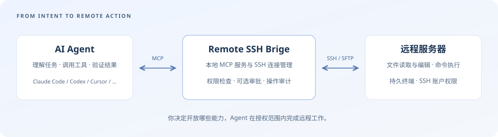

<div align="center">


# Remote SSH Brige

**让 AI Agent 通过 MCP，读写和操作你的远程服务器。**

连接 SSH · 读写文件 · 执行命令 · 持久终端 · 权限与审批

[快速开始](#快速开始) · [核心思想](#核心思想) · [MCP 工具](#mcp-工具) · [开发指南](#开发)

Tauri 2 / Rust / React / TypeScript

</div>

---

把远程服务器接入 Agent 的工作流。Agent 可以读取配置、分析日志、修改文件，再运行命令验证结果。你可以在桌面端管理服务器、授权工具、处理审批和查看执行记录。

支持 **Claude Code、Codex、Gemini CLI、OpenCode、Cursor 和 Pi** 一键配置接入。

## 核心思想

### Agent 提出操作，MCP 连接工具，SSH 抵达服务器

你描述任务，Agent 调用已授权的工具。应用通过 SSH 执行命令、通过 SFTP 读写文件，再将结果返回给 Agent。



### 连接配置留在本地，能力按需开放

服务器的连接和权限在桌面端管理。密码和私钥口令保存在系统凭据库。交互终端和端口转发可以在「设置 → MCP 高级工具」中分别开启。

### 让修改有依据，让结果可核验

先读原文，再用 `edit_file` 定点修改、检查差异，最后读回文件或执行已授权的验证命令。应用在本地记录操作目标、结果和耗时。

## 快速开始

1. 在「服务器」添加连接，核对 SHA-256 主机指纹后测试连接。
2. 启用服务器的 MCP 访问，授予所需权限。
3. 在「MCP 服务」启动服务并配置客户端。默认端点为 `http://127.0.0.1:18920/mcp`，使用 Streamable HTTP 和 Bearer Token。重启服务后，手动配置的客户端需更新 Token。

## MCP 工具

| 用途                 | 工具                                                                             |
| -------------------- | -------------------------------------------------------------------------------- |
| 查找服务器和权限     | `list_servers`、`server_info`                                                    |
| 执行命令和跟踪任务   | `exec`、`exec_approved`、`job`                                                   |
| 浏览和修改文件       | `list_files`、`stat_file`、`read_file`、`write_file`、`edit_file`、`remove_path` |
| 上传、下载和管理传输 | `upload_file`、`download_file`、`transfer`                                       |
| 交互终端和端口转发   | `terminal`、`port_forward`                                                       |

输出可以是正文或精简 JSON。分页、游标和历史输出丢失提示随正文返回。收到 `APPROVAL_REQUIRED` 时用相同参数调用 `exec_approved`，由桌面用户审批。执行或提交结果未知时，先检查远端状态再决定是否重试。传输的本地路径位于运行桌面应用的主机。

在「设置 → 安全控制」可逐行添加自定义保护规则。`docker rmi` 匹配以这两个词开头的命令，单写 `docker` 则保护所有 Docker 子命令。

## 自动更新

「设置 → 关于与更新」显示当前版本并检查 GitHub Releases 中的签名更新。下载和安装必须由用户确认；MCP 正在运行时会先询问是否停止服务。停止失败或仍有活动请求时不会开始安装。

发布签名更新需要配置以下仓库 Secrets：

- `TAURI_SIGNING_PRIVATE_KEY`：minisign 私钥内容或文件路径。
- `TAURI_SIGNING_PRIVATE_KEY_PASSWORD`：私钥口令。

`src-tauri/tauri.updater.conf.json` 启用 `createUpdaterArtifacts`，仅在有签名密钥时参与构建。更新公钥和 `latest.json` 地址位于 `src-tauri/tauri.conf.json` 的 `plugins.updater`。

## 开发

需要 Node.js 24.15+、Rust stable 和 Tauri 构建环境。Windows 需 MSVC Build Tools、WebView2 和 Perl，macOS 需 Xcode Command Line Tools。

```sh
npm ci
npm run desktop          # 运行桌面应用
npm run desktop:build    # 构建安装包
npm test                 # Rust 测试
npm run test:ui          # 前端测试
npm run build:headless
npm run test:e2e         # 本地 SSH/SFTP 与 MCP 集成测试
```

MIT License
