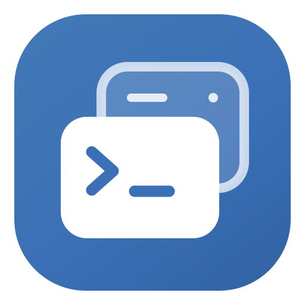

# Remote SSH Bridge

### 让 AI Agent 安全连接你的远程服务器

SSH · SFTP · MCP · 审批控制

[下载最新版](https://github.com/YKONGCO/Remote-SSH-Brige/releases/latest)　·　[快速开始](#快速开始)　·　[功能介绍](#功能)

Remote SSH Bridge 是一款 **remote ssh mcp** 桌面应用，可将 SSH 服务器接入 AI Agent 的工作流。MCP 服务运行在本机，Agent 可在授权范围内执行命令、管理文件和跟踪任务。

支持 Claude Code、Codex、Gemini CLI、OpenCode、Cursor 和 Pi。服务器连接、工具权限及操作审批均可在桌面应用中管理；密码和私钥口令保存在系统凭据库。

## 快速开始

1. 从[最新版本](https://github.com/YKONGCO/Remote-SSH-Brige/releases/latest)下载并安装应用。
2. 在「服务器」中添加 SSH 连接，核对 SHA-256 主机指纹并测试连接。
3. 为服务器启用 MCP 访问，并只授予需要的工具权限。
4. 在「MCP 服务」启动服务，然后在客户端配置页面选择或复制连接配置。

默认 MCP 地址为 `http://127.0.0.1:18920/mcp`，使用 Streamable HTTP 和 Bearer Token。重启 MCP 服务后，手动配置的客户端需要更新 Token。

## 功能

- 使用 SSH 执行命令，并按需通过桌面审批受保护的操作。
- 通过 SFTP 浏览、读取、编辑、上传和下载文件。
- 查看任务状态与操作记录；支持交互终端和端口转发（需在设置中启用）。
- 对危险命令配置自定义保护规则。

收到审批请求时，请在桌面应用中检查并批准。命令或传输结果不确定时，先检查远端状态再重试。

## 许可证

MIT
